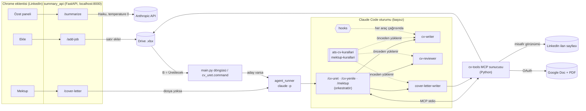

# Job Application Agent

**Multi-Agent CV Automation on Claude Code + LinkedIn Assistant**

Kişisel iş aramam için kurduğum bir **Claude Code agent sistemi**. İki işi var:

1. Drive'daki başvuru listemde **başvurmaya karar verdiğim** her ilan için o ilana özel, ATS uyumlu
   **İngilizce CV** üretmek (Markdown + Google Doc + PDF), istersem aynı ilan için cover letter yazmak.
2. LinkedIn'de gezinirken seçili ilanın kısa **Türkçe özetini** ve teknoloji uyum puanını bir Chrome
   eklentisinin yan panelinde göstermek.

Sistem yalnızca Claude modelleriyle çalışır. CV ve mektup Claude Code agent'larıyla (abonelik
girişiyle) üretilir. Anthropic API'yi doğrudan çağıran tek yer, her ilan açılışında ~2 saniyede
dönmesi gereken panel özetidir.

## Mimari



**Tasarım ilkesi: değişmezler araçlarda, muhakeme agent'larda.** LLM akışı yönetir ve metni yazar.
CV numarası ayırma, kalkmış ilanı işaretleme, tekrar kontrolü, sheet kilidi ve çıktı ayrıştırma ise
MCP sunucusunun içindeki deterministik Python kodunda kalır. Agent bir numarayı yanlış yazsa ya da bir
adımı atlasa bile sheet bozulmaz.

### Claude Code özellikleri nerede kullanılıyor

| Özellik | Bu projede | Dosya |
|---|---|---|
| **Slash command (orkestrasyon)** | `/cv-uret`: aday satırları bulur, her satır için subagent'a CV yazdırır, sonucu kesinleştirir. `/cv-yenile` serbest metin talimatıyla yeniden üretir, `/mektup` istendiğinde mektup yazar | `.claude/commands/` |
| **Subagent'lar** | `cv-writer` (drafter), `cv-reviewer` (ikinci uzman, isteğe bağlı), `cover-letter-writer`. Her biri temiz bağlamla ve yalnızca gereken araçlarla çalışır | `.claude/agents/` |
| **Skill'ler** | ATS kuralları ve dürüstlük sözleşmesi (5 dosyaya bölünmüş), mektup kuralları. `skills:` ile subagent'a önceden yüklenir | `.claude/skills/` |
| **MCP sunucusu** | `cv-tools`: 7 araç (aday listesi, ilan okuma, CV sonlandırma, yeniden üretim, mektup bağlamı/kaydı). Agent'lar sheet'e, LinkedIn'e ve Drive'a yalnızca buradan dokunur | `src/applyjobs/mcp_server.py`, `.mcp.json` |
| **Hook'lar** | `PreToolUse`: `credentials/`, `.env` ve LinkedIn oturum dosyasına erişimi engeller. `PostToolUse`: yazılan CV'yi .docx'i üreten ayrıştırıcıyla okur, bozuksa agent'a düzelttirir | `.claude/hooks/` |
| **İzinler** | Başsız oturum `dontAsk` modunda: yalnızca cv-tools, Read ve `outputs/**`'a yazma serbest; Bash/WebFetch kapalı | `.claude/settings.json` |
| **Loop / otomasyon** | `main.py` sheet'i yoklar (model çağırmadan), iş varsa `claude -p "/cv-uret"` başlatır. Alternatif: Claude Code içinde `/loop 10m /cv-uret` | `src/applyjobs/main.py`, `agent_runner.py` |

Plugin kullanılmadı: tek bir depo için proje seviyesindeki `.claude/` klasörü yeterli. Plugin
paketlemesi bu yapıyı başka depolara dağıtmak gerektiğinde anlamlı olur.

## Dürüstlük sözleşmesi

CV'nin her satırı mülakatta savunulabilir olmalı. Kurallar ilandaki her anahtar kelimeyi üç türe ayırır:

| Tür | Ne demek | Kural |
|-----|----------|-------|
| **Hard-Tech** | Kurulabilen, adı olan teknoloji (Redis, Kafka, Spring Boot, AWS) | 🔒 `profile/cv_base.md` ya da `profile/projects.md`'de yoksa **CV'ye asla girmez** |
| **Hard-Practice** | Ürün adı vermeyen pratik ya da nitelik (debugging, best practices, documentation, scalability) | ✅ Soft skill gibi var olan işe örülür |
| **Soft** | Kişilerarası özellik (communication, teamwork) | ✅ Hepsi eklenir |

Markdown CV'de **kalın**, `cv_base.md`'ye göre değişen kelimeleri gösterir. Böylece neyin eklendiği tek
bakışta denetlenir. Kalın, `.docx`/Doc/PDF'e geçmez. Kalın bir ekleme tarz ya da işe içkin bir pratik
kelimesi ekleyebilir; asla yeni bir teknoloji, alan, işveren ya da metrik ekleyemez.

## Tetikleme kuralı

Bir satır şu durumda işlenir: **K (link) dolu**, **N (CV No) boş** ve **B (Başvuru) = `Üretilecek`**.

1. İlandayken panelin **Ekle** butonu satırı tabloya ekler (link + pozisyon + firma). B boş kalır.
2. Başvuracağın gün satırın **B** sütununu `Üretilecek` yap.
3. `scripts/cv_uret.command`'a çift tıkla (ya da poller açıksa ~20 sn içinde kendisi alır).

İlan o sırada yayından kalkmışsa CV üretilmez: N'ye `Kalkmış` yazılır, CV numarası harcanmaz.

## Kurulum

```bash
python -m venv .venv
./.venv/bin/pip install -r requirements.txt
./.venv/bin/playwright install chromium
cp .env.example .env        # SPREADSHEET_ID, SHEET_NAME, ANTHROPIC_API_KEY (yalnızca panel özeti) …
claude                      # Claude Code'a bir kez giriş yap
claude mcp list             # cv-tools: ✔ Connected
```

- **Google servis hesabı:** liste Drive'da bir `.xlsx` dosyası. Google Drive API'yi açın, bir servis
  hesabı anahtarını `credentials/service_account.json` olarak kaydedin ve dosyayı o hesabın e-postasıyla
  **Editor** olarak paylaşın. `SPREADSHEET_ID` dosyanın Drive kimliği.
- **Google Doc/PDF çıktısı (OAuth, tek seferlik):** OAuth istemcisini (Desktop app)
  `credentials/oauth_client.json` olarak kaydedip `./.venv/bin/python scripts/google_login.py`
  çalıştırın. Drive'da "Resumes Based on Jobs" klasörü olmalı. Bu adım atlanırsa Markdown CV yine üretilir.
- **Eklenti:** `chrome://extensions` → Developer mode → **Load unpacked** → `extension/`.

## Kullanım

```bash
./scripts/start.sh                                   # özet API + CV poller
./scripts/start_api.sh                               # yalnızca API (LinkedIn'de gezinirken)
./scripts/cv_uret.command                            # işaretli satırlar için tek geçiş
./.venv/bin/python scripts/run_once.py --dry-run     # adayları listele, hiçbir şey yazma
./.venv/bin/python scripts/regenerate.py --from 309 --to 309 -i "Feature a .NET project"
./.venv/bin/python scripts/cover_letter.py --cv-no 305 --lang tr
```

Ayrıntılı Türkçe kullanım kılavuzu: [KULLANIM.md](KULLANIM.md). Geliştirici notları ve tasarım
kararlarının gerekçeleri: [docs/mimari-ve-tuzaklar.md](docs/mimari-ve-tuzaklar.md).

## Üretilen dosyalar (git'e girmez)

| Dosya | Konum |
|-------|-------|
| `cv_<no>.md` (optimize CV) | `outputs/cv/markdown/` |
| `cv_<no>.pdf` | `outputs/cv/pdf/` |
| `cv_<no>` (Google Doc) | Drive → "Resumes Based on Jobs" |
| `cv_<no>_analysis.md` (Türkçe ATS analizi + skor) | `outputs/cv/analysis/` |
| `job_description_<no>.md` (okunan ilan metni) | `outputs/job_descriptions/` |
| `cover_letter_<no>_<dil>.md` | `outputs/cover_letters/` |
| CV No → N, Match Rate → P, öncelikli diller → Q | Drive'daki tablo |

## Yapı

```
.claude/
  commands/   cv-uret.md, cv-yenile.md, mektup.md           orkestratörler
  agents/     cv-writer.md, cv-reviewer.md, cover-letter-writer.md
  skills/     ats-cv-kurallari/ (SKILL.md + 01–05), mektup-kurallari/
  hooks/      guard_secrets.py, check_cv_output.py
  settings.json                                              izinler + hook kayıtları
.mcp.json                                                    cv-tools MCP sunucusu
profile/      cv_base.md, projects.md, projects_list.md      adayın gerçekleri (tek kaynak)
templates/    cv_template.docx
prompts/      ozet_sistem.md                                 panel özetinin system prompt'u
src/applyjobs/
  mcp_server.py    cv-tools araçları (değişmezler burada)
  agent_runner.py  claude -p başlatıcısı (abonelik, izinler, kilit)
  main.py          döngü: aday varsa agent'ı başlatır
  pipeline.py      aday seçimi, ilan okuma, Google Doc/PDF dışa aktarımı
  cv_output.py     agent çıktısını ayrıştırma + satıra özel kural parçaları
  sheets.py        .xlsx indir/düzenle/yükle + süreçler arası kilit
  scraper.py       Playwright, yalnızca misafir görünümü
  docx_builder.py  Markdown CV → .docx şablonu
  drive_docs.py    .docx → Google Doc → PDF (OAuth)
  cover_letter.py  mektup önbelleği + mektup agent'ı
  joblookup.py     CV No ↔ ilan no, panelin kaydettiği ilan metni
  summary_api.py   eklentinin backend'i (özet, uyum puanı, Ekle, Mektup)
extension/    Chrome MV3 eklentisi
scripts/      start.sh, start_api.sh, cv_uret.command, run_once.py, regenerate.py, cover_letter.py, …
outputs/      üretilen dosyalar (gitignore)
state/        last_cv_no, summary_cache.json, kilitler, loglar (gitignore)
```

## Notlar

- Kullanıcının LinkedIn oturum çerezi hiçbir otomatik tarayıcıya bağlanmaz. Bir kez bağlandığında
  LinkedIn hesabı haftalarca bütün oturumları kapatmıştı. Scraper yalnızca herkese açık görünümü okur,
  eklenti LinkedIn'e hiçbir istek atmaz (sadece sayfadaki metni localhost'a gönderir).
- `profile/`, `.claude/` ve `prompts/` altındaki Markdown dosyaları **veridir**. Hiçbir biçimlendirici
  dokunmamalı (`.prettierignore` ve `.vscode/settings.json` engelliyor).
- Ölçülen maliyet: medium effort'ta bir CV ~6 dakika sürüyor ve ~$0.95 eşdeğer abonelik kotası
  harcıyor (eski doğrudan API yolu ~$0.16 faturalanıyordu). Fark, Claude Code oturumunun sabit ek yükü.
